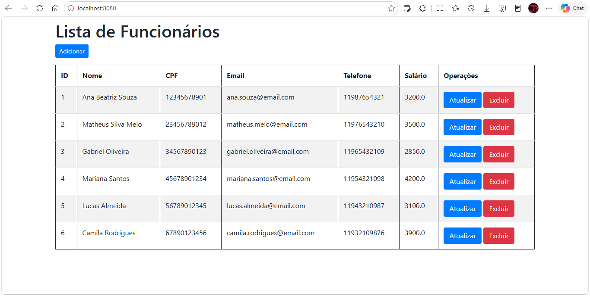
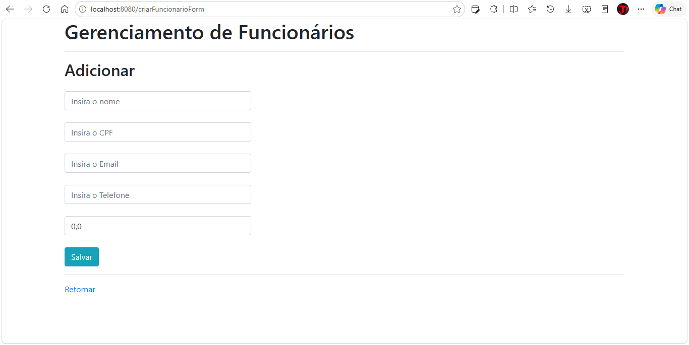
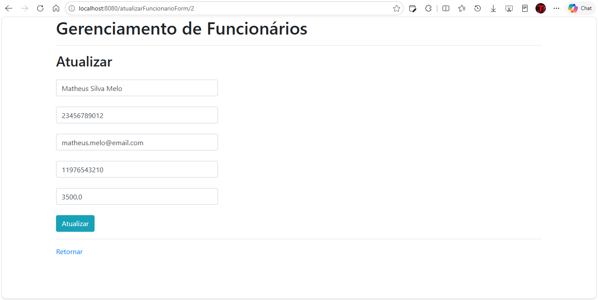
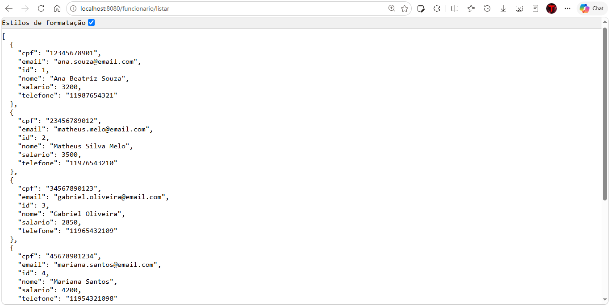
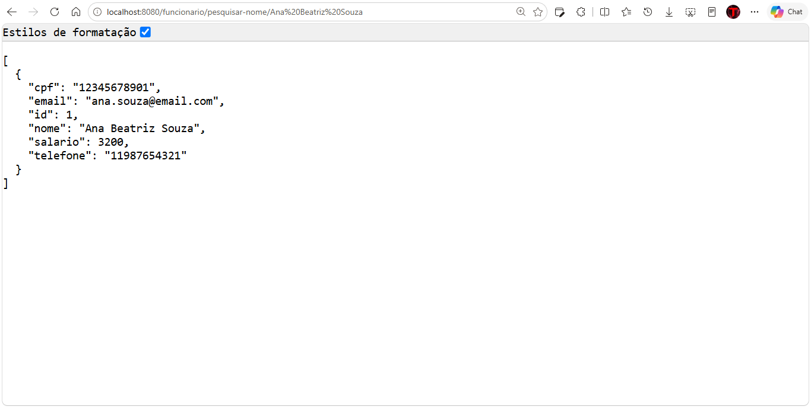
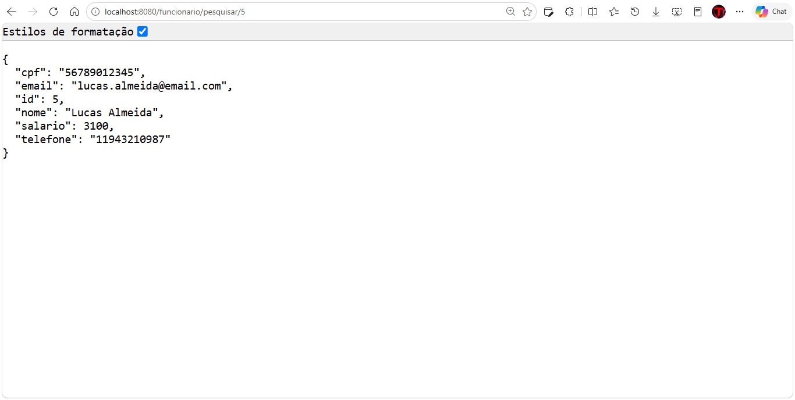
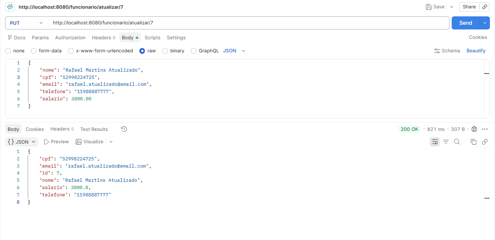
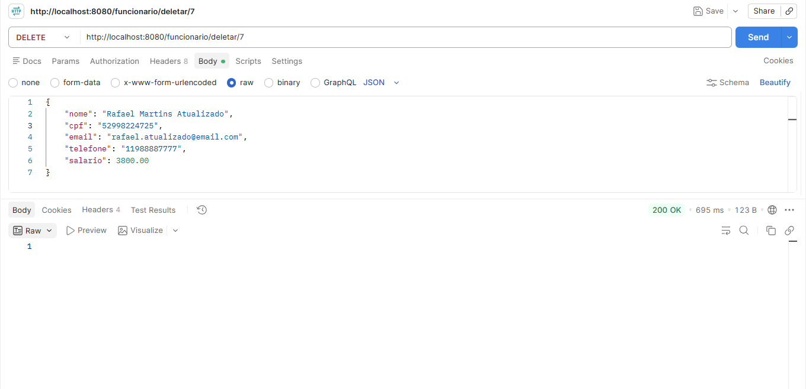

# CRUD de Funcionários — Spring Boot

## 📖 Sobre o projeto

Projeto desenvolvido durante os estudos do curso **Técnico em Desenvolvimento de Sistemas — Senac EAD**.

O projeto consiste em um sistema de gerenciamento de funcionários desenvolvido com **Java + Spring Boot + MySQL**, implementando operações de CRUD:

* Criar funcionários
* Listar funcionários
* Pesquisar funcionários
* Atualizar funcionários
* Excluir funcionários

O projeto apresenta duas formas de utilização do sistema:

1. **API REST** — comunicação através de requisições HTTP e retorno de dados em JSON.
2. **API MVC** — interface web utilizando Spring MVC e Thymeleaf para realizar o CRUD através de páginas HTML.

---

## 🚀 Tecnologias utilizadas

* Java 17
* Spring Boot 4.1.1
* Spring MVC
* Spring Data JPA
* Hibernate
* Thymeleaf
* MySQL
* Maven
* Lombok
* Bean Validation
* Bootstrap
* Postman

---

# 🏗️ Arquitetura do projeto

O projeto utiliza uma estrutura baseada em camadas:

```text
Controller
    ↓
Service
    ↓
Repository
    ↓
MySQL
```

### API REST

```text
Postman
   ↓
REST Controller
   ↓
Service
   ↓
Repository
   ↓
MySQL
```

A API REST recebe requisições HTTP e retorna os dados em formato JSON.

### API MVC

```text
Navegador
   ↓
Controller MVC
   ↓
Service
   ↓
Repository
   ↓
MySQL
   ↓
Model
   ↓
Thymeleaf
   ↓
HTML
   ↓
Navegador
```

A API MVC utiliza o Spring MVC e o Thymeleaf para apresentar os dados através de páginas HTML.

---

# 🌐 API MVC

A API MVC permite realizar o gerenciamento dos funcionários através de uma interface web.

## 📋 Lista de funcionários

A página inicial apresenta os funcionários cadastrados no banco de dados.



A tabela apresenta informações como:

* ID
* Nome
* CPF
* E-mail
* Telefone
* Salário

Também estão disponíveis as operações de:

* Atualizar
* Excluir

---

## ➕ Cadastro de funcionário

Através da página de cadastro é possível inserir um novo funcionário.



O formulário utiliza **Thymeleaf** para associar os campos HTML ao objeto `FuncionarioEntity`.

---

## ✏️ Atualização de funcionário

A página de atualização permite editar os dados de um funcionário existente.



O ID do funcionário é mantido através de um campo oculto no formulário, permitindo que o Controller identifique qual registro deve ser atualizado.

---

# 🔌 API REST

Além da interface MVC, o projeto possui uma API REST para acesso aos dados através de requisições HTTP.

Os testes foram realizados utilizando o **Postman**.

## 📋 Listar funcionários

Endpoint utilizado para consultar todos os funcionários:

```text
GET /funcionario/listar
```



---

## 🔎 Pesquisar por nome

A API também permite pesquisar funcionários pelo nome:

```text
GET /funcionario/pesquisar-nome/{nome}
```

Exemplo:

```text
GET /funcionario/pesquisar-nome/Matheus Silva Melo
```



---

## 🔎 Pesquisar por ID

Também é possível consultar um funcionário utilizando seu ID:

```text
GET /funcionario/pesquisar/{id}
```

Exemplo:

```text
GET /funcionario/pesquisar/5
```



---

## ➕ Adicionar funcionário

A API REST permite cadastrar um funcionário através de uma requisição `POST`.

```text
POST /funcionario/cadastrar
```

Os dados são enviados em formato JSON.


---

## ✏️ Atualizar funcionário

Para atualizar um funcionário é utilizada uma requisição `PUT`.

```text
PUT /funcionario/{id}
```

Os novos dados são enviados através de JSON.



---

## 🗑️ Excluir funcionário

A API também permite excluir um funcionário através de uma requisição `DELETE`.

```text
DELETE /funcionario/{id}
```



---

# 🗄️ Banco de dados

O projeto utiliza **MySQL** para armazenamento dos funcionários.

O script para criação da estrutura do banco está disponível em:

```text
banco/funcionario.sql
```

O banco utilizado pelo projeto é:

```text
controle_funcionarios
```

A tabela principal é:

```text
Funcionario
```

Estrutura básica:

```text
Funcionario
├── id
├── cpf
├── email
├── nome
├── salario
└── telefone
```

O campo `id` utiliza geração automática através do `AUTO_INCREMENT` do MySQL.

---

# 📁 Estrutura do projeto

```text
crud-funcionarios-spring/
│
├── banco/
│   └── funcionario.sql
│
├── screenshots/
│   ├── mvc/
│   │   ├── 01-lista-funcionarios.png
│   │   ├── 02-cadastro-funcionario.png
│   │   └── 03-atualizacao-funcionario.png
│   │
│   └── rest/
│       ├── 01-listar-funcionarios.png
│       ├── 02-pesquisar-por-nome.png
│       ├── 03-pesquisar-por-id.png
│       ├── 04-adicionar-funcionario.png
│       ├── 05-atualizar-funcionario.png
│       └── 06-excluir-funcionario.png
│
├── src/
│   ├── main/
│   │   ├── java/
│   │   └── resources/
│   │       ├── static/
│   │       └── templates/
│   │
│   └── test/
│
├── pom.xml
├── README.md
└── .gitignore
```

---

# 🎓 Contexto acadêmico

Este projeto foi desenvolvido como parte dos estudos do curso:

**Técnico em Desenvolvimento de Sistemas — Senac EAD**

Durante o desenvolvimento foram aplicados conhecimentos relacionados a:

* Java
* Spring Boot
* Spring MVC
* APIs REST
* Spring Data JPA
* Hibernate
* Thymeleaf
* MySQL
* Maven
* Validação de dados
* CRUD
* Arquitetura em camadas
* Requisições HTTP
* JSON
* Bootstrap
* Testes utilizando Postman

O projeto também foi utilizado como prática para compreender a diferença entre uma **API REST**, que trabalha com dados e JSON, e uma **aplicação MVC**, que utiliza Controllers, Model e Views HTML.

---

# 🎯 Objetivo

O objetivo do projeto é colocar em prática o desenvolvimento de uma aplicação completa utilizando Spring Boot, desde o acesso ao banco de dados até a apresentação das informações em uma interface web e a disponibilização dos dados através de uma API REST.

O repositório também serve como material de consulta para futuros projetos utilizando **Spring Boot, JPA, REST e Spring MVC**.

---

# 👨‍💻 Projeto acadêmico

**Curso:** Técnico em Desenvolvimento de Sistemas
**Instituição:** Senac EAD
**Tecnologias principais:** Java + Spring Boot + MySQL

⭐ Projeto desenvolvido para prática e consolidação dos conhecimentos em desenvolvimento de sistemas.